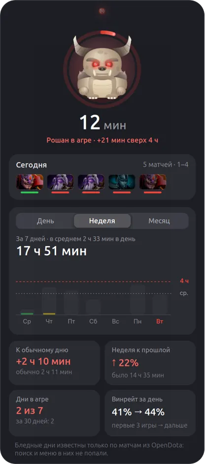
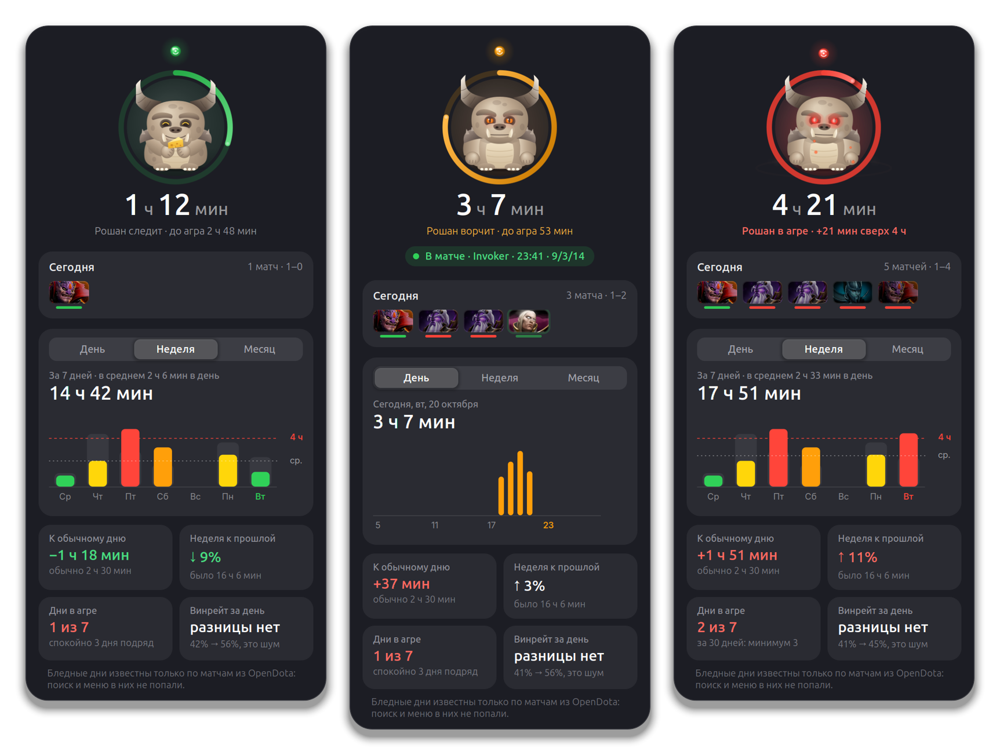
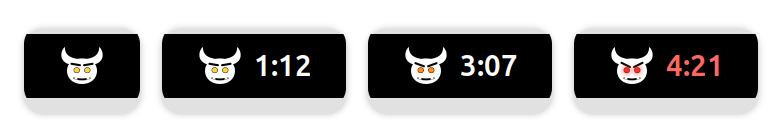

# Dota Time

[](https://github.com/lilter96/gnome-dota-time/actions/workflows/test.yml)

A GNOME Shell extension that shows how long you have been in Dota 2 today, right
in the top bar. Roshan lives next to it. He sleeps while Dota is closed, wakes up
when it starts, grumbles as the evening goes on and goes into aggro after four
hours. The popup has the day's matches with their heroes, charts for the day, the
week and the month, and comparisons that only compare like with like.

<p align="center">
  
</p>





<sub>Rendered at 2× in a throwaway headless GNOME Shell by
[`tools/media/capture.sh`](tools/media/capture.sh). The data is made up: a month
of evenings built by a generator inside the script. The UI text is Russian.</sub>

## What counts as time in Dota

**A match always counts; everything else only while Dota is in front of you.**
During a match the time runs even if you alt-tab away while waiting to respawn.
Outside a match, in the menu or in the queue, it runs only while Dota's window
has focus. Dota idling in the background while you sit in a browser does not
count. The demo hero, practice games and the arcade never count. If you are not
in a match and there is no keyboard or mouse input for ten minutes, those ten
minutes are taken back. The extension is off while the screen is locked, so that
time does not count either. The popup says why the time is standing still, for
example "Дота в фоне, время стоит" (Dota is in the background).

**A day starts at 05:00.** A game at two in the morning belongs to the evening it
started from, not to a new day.

**Live matches come from Game State Integration**, Valve's official channel for
Dota to report on a game. The extension puts
`gamestate_integration_dota_time.cfg` into `game/dota/cfg/gamestate_integration/`
and listens on `127.0.0.1:47570` with a random token. Posts without the token are
dropped. This gives the hero, the game clock, K/D/A and the result, and Roshan is
happy about a win and upset about a loss. Since 2022 Dota only sends this with the
[`-gamestateintegration`](https://liquipedia.net/dota2/Launch_Options) launch
option. Add it under Steam → Dota 2 → Properties → Launch Options. The extension
reads Dota's command line, and while the option is missing the popup has a button
that copies it. Dota stays silent until the first game: the first post arrives
when a map loads. The demo hero, practice and the arcade show up as a cyan line
and never become matches.

**History comes from OpenDota.** The account is the one that last signed in to
Steam, from `loginusers.vdf`. The extension pulls 60 days of matches so the charts
are not empty on day one, and refreshes the last 20 matches after a game. Days
before the install are known only by their match durations. The queue, the draft
and the menu are missing, so they are a lower bound and their bars are paler.
OpenDota can only see your matches if Expose Public Match Data is on in Dota's
settings.

## Comparisons

Only like is compared with like. A day the extension saw whole includes the menu
and the queue. A day from OpenDota knows only the match clock. Side by side, every
new day would look longer than the old ones. So while either side has days known
only by their matches, both sides count time in matches, and the tile says so:
"День в матчах" (the day in matches), "Неделя в матчах" (the week in matches).
Once enough days have been seen whole, the tiles switch to the whole time. Days
are counted as whole from the day after the install, because the install day
began before the extension did.

| Tile | How it is counted |
|---|---|
| **К обычному дню** (against a usual day) | Today against the median of the last 28 days you played. The whole time is compared once there are three played days seen whole; until then, time in matches. |
| **Неделя к прошлой** (week against the last) | Seven days against the seven before them. The whole time is compared if the previous week was seen whole; otherwise time in matches on both sides. |
| **Дни в агре** (aggro days) | Days of four hours or more in the week and in the month, and how many days in a row went without aggro. If the period has days known only by their matches, the count is marked as a minimum, since such a day may have been longer. Calm days are counted only among days seen whole. |
| **Винрейт за день** (win rate through the day) | The first three games of a day against the rest, raw. A two-sided Fisher exact test checks the gap. If p ≥ 0.05 the tile says "разницы нет" (no difference) and stays uncoloured, because chance alone often gives a gap that size. The tile appears once each group has at least 8 games; until then it shows the week's matches. |

On the week chart, grey ghosts behind the bars show the previous week. If a day
of the previous week is known only by its matches while this week's day was seen
whole, its ghost is not drawn, because that comparison would not be fair.

## Stays out of the game's way

- **The panel does not move.** While Dota is fullscreen and focused, the panel
  item does not animate. It just snaps to its new state.
- **No banner over the game.** The four-hour notification comes once a day at
  normal urgency. GNOME does not show such a banner over a fullscreen window, so
  it waits in the notification list.
- **Focus never moves.** This matters: with `snd_mute_losefocus 1`, Dota goes
  silent the moment it loses focus.

## Install

Needs GNOME Shell 46.

```sh
git clone https://github.com/lilter96/gnome-dota-time
ln -s "$PWD/gnome-dota-time/dota-time@terentiy" ~/.local/share/gnome-shell/extensions/
gnome-extensions enable dota-time@terentiy
```

Then restart the Shell: Alt+F2 → `r` on X11, or log out and back in on Wayland.
After that, add `-gamestateintegration` to Dota's launch options.

## Data

- **Where it lives:** the state in `~/.local/state/dota-time/state.json`, hero
  portraits from the Steam CDN in `~/.cache/dota-time/heroes/`.
- **Network:** only `api.opendota.com` and `cdn.cloudflare.steamstatic.com`.
- **Keys:** none needed.
- **First version:** if its `history.json` is found next to the state, it is
  imported once.

## Development

```sh
gjs -m tests/run.js                  # time keeping, GSI, Roshan
gjs -m tools/frames.js out.png 2     # Roshan in every state, no Shell restart
gjs -m tools/glyph.js out.png        # the panel item, large
tools/media/capture.sh smoke         # a real Steam account, OpenDota and a GSI post in an isolated Shell
tools/media/capture.sh media         # README media from made-up data
```

Both captures start a throwaway `gnome-shell --headless` with its own bus, dconf,
XDG directories and even `$HOME`, which holds a fake Steam. That keeps the test
GSI config out of the real Dota. `--mode=user` is deliberate: the Ubuntu mode
loads Desktop Icons NG, whose `init()` kills the desktop icons process of your
real session.

## Limitations

- The UI is in Russian only.
- Tested with one Steam account on GNOME 46 under X11.
- Real GSI posts have been seen from the menu and the demo hero. A live ranked
  match has so far been checked only with synthetic posts shaped like Dota's.
- Days before the install are a lower bound; see [Comparisons](#comparisons).

A sibling of [gnome-headphones-battery](https://github.com/lilter96/gnome-headphones-battery):
the same spring animation and the same approach to a character.

## License

[MIT](LICENSE)
